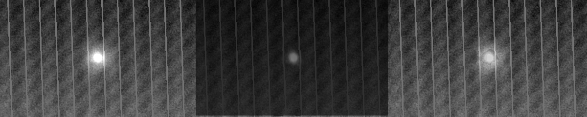

# Stereo Glare Suppression | 双目夜间眩光抑制

用同步拍摄的正常曝光图和减光图抑制夜间车灯、路灯及湿路反光。正常曝光图保留暗部，可靠对齐的减光图补充强光区域。支持双图、左右拼接图像或视频，以及同步双目拼接相机。

下图从左到右为合成场景的正常曝光、对齐减光和最终输出。



## 快速运行

需要 Python 3.10–3.13。CPU 即可运行，无模型权重或外部数据下载。建议使用虚拟环境。

```bash
python -m venv .venv
```

Windows PowerShell 用 `.\.venv\Scripts\Activate.ps1`，macOS 或 Linux 用 `source .venv/bin/activate` 激活后运行：

```bash
python -m pip install -r requirements.txt
python -m unittest -v test_pipeline
python make_demo.py --out samples/synthetic
python run.py image --packed samples/synthetic/packed.png --out outputs/synthetic
```

Windows 也可以在安装依赖后双击 `run_demo.cmd`，运行测试和合成样例。

## 使用自己的双目素材

```bash
python run.py image --left left.png --right right.png --out outputs/image
python run.py video --packed stereo.mp4 --out outputs/video --video-out outputs/video/fused.mp4
python run.py video --left left.mp4 --right right.mp4 --out outputs/pair --video-out outputs/pair/fused.mp4
```

- 默认左路是正常曝光，右路是减光。顺序相反时加 `--normal-side right`。双文件按帧序号配对，须在采集时同步并保持帧率、帧数一致。
- 左右拼接帧默认等宽拆分。有边缘留白时可传 `--crop-config crop.json`，文件包含 `left_crop` 和 `right_crop`，各自使用像素字段 `x`、`y`、`width`、`height`。
- 未校正的输入可通过 `--calibration` 传入自身设备的 JSON 或 NPZ。JSON 包含 `[宽, 高]` 格式的 `image_size`、`left_camera_matrix`、`left_distortion`、`right_camera_matrix`、`right_distortion`、双目旋转 `R` 和平移 `T`。NPZ 预计算映射表使用 `map1x`、`map1y`、`map2x`、`map2y`。
- 已校正图像若有黑边，可传 `--mask left-valid.png right-valid.png`；白色为有效区域。视频输出保留帧率，没有音轨。

`python run.py camera --help` 查看拼接相机预览和原始录像参数。硬件须自行保证同步，实体相机入口未在公开样例中验证。

## 算法与输出

1. 灰度曝光归一化，多尺度双向 DIS 光流和双线性重采样。
2. 分开计算采样有效性、局部结构置信度和正反向一致性。
3. 通过灯芯、候选光晕、可靠位置上的亮度增益和亮度残差形成强光门控。
4. 用时间平滑及滞回控制减光路的 CLAHE 辅助增强，按可靠性分配三路权重，再做拉普拉斯金字塔融合。
5. 压缩高光，并限制局部融合产生的亮度突降，保留暗部基调和灯光过渡。

`--out` 保存处理首帧的诊断。`raw_fused.png` 为显示调整前的融合，`fused.png` 为最终图像。`fields.npz` 含光流、置信度和融合权重；`report.json` 含参数、亮度增益和高光统计。

使用 `--config config.json` 覆盖默认参数。例如 `{"highlight_rolloff": 0.38, "fusion_drop_limit": 32.0}` 会加强高光压缩并限制减光落差。将 `highlight_rolloff` 设为 0 可以关闭显示调整。

已经饱和且在减光图中找不到可靠对应位置的纹理无法恢复。本项目使用可控的合成场景测试，离线结果会随曝光差、双目同步和校正质量变化。
